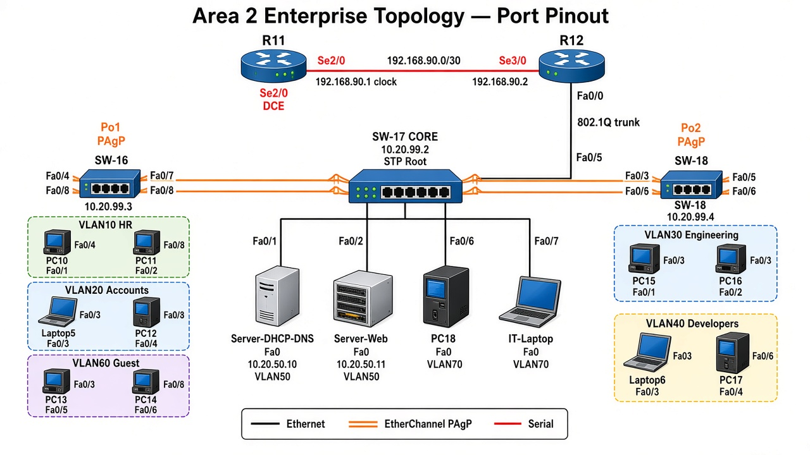

# Area 2 Enterprise Network Lab

## Tutorial Module — Rebuild It Yourself

**Audience:** CCNA / networking students  
**Platform:** Cisco Packet Tracer  
**Devices:** Router12 (R12), SW-16, SW-17, SW-18, servers, PCs/laptops  
**Time estimate:** 2–4 hours  

---

## 1. Learning Objectives

By the end of this lab you will be able to:

1. Design and cable a small **three-switch enterprise** topology  
2. Create **department VLANs** and assign access ports  
3. Configure **802.1Q trunks** and a **native VLAN**  
4. Build **Router-on-a-Stick (ROAS)** for inter-VLAN routing  
5. Deploy **central DHCP** with `ip helper-address`  
6. Apply **ACLs** to protect HR/Accounts and isolate Guest  
7. Secure edge ports with **port-security**, **PortFast**, and **BPDU Guard**  
8. Set **Rapid-PVST+** and make the core switch the **STP root**  
9. Bundle uplinks with **PAgP EtherChannel** for link redundancy  
10. Advertise the site with **OSPF Area 2**  

---

## 2. Topology Overview

### 2.1 Picture (connections and ports)



**How to read the picture**

| Color | Meaning |
|---|---|
| Red | Serial WAN |
| Black | Ethernet access or single trunk |
| Orange (double) | EtherChannel PAgP (two cables) |

> **Cable from the pinout tables below.** Use the picture for layout; if a label on the drawing is hard to read, the tables are the source of truth.

### 2.2 Connection pinout (source of truth)

#### WAN and ROAS

| From device | From port (pin) | To device | To port (pin) | Cable | Notes |
|---|---|---|---|---|---|
| R11 | **Se2/0** | R12 | **Se3/0** | Serial DCE | R11 = DCE + clock; `192.168.90.0/30` |
| R12 | **Fa0/0** | SW-17 | **Fa0/5** | Straight-through | 802.1Q trunk (ROAS) |

#### SW-17 core — servers and IT

| From device | From port | To device | To port | VLAN / role |
|---|---|---|---|---|
| SW-17 | **Fa0/1** | Server-DHCP-DNS | Fa0 | VLAN 50 |
| SW-17 | **Fa0/2** | Server-Web | Fa0 | VLAN 50 |
| SW-17 | **Fa0/6** | PC18 (IT) | Fa0 | VLAN 70 |
| SW-17 | **Fa0/7** | IT Laptop | Fa0 | VLAN 70 |

#### EtherChannel Po1 (SW-17 ↔ SW-16) — PAgP

| Member | SW-17 pin | SW-16 pin |
|---|---|---|
| Link 1 | **Fa0/4** | **Fa0/7** |
| Link 2 | **Fa0/8** | **Fa0/8** |

#### EtherChannel Po2 (SW-17 ↔ SW-18) — PAgP

| Member | SW-17 pin | SW-18 pin |
|---|---|---|
| Link 1 | **Fa0/3** | **Fa0/5** |
| Link 2 | **Fa0/9** | **Fa0/6** |

#### SW-16 access ports

| SW-16 pin | End device | Device pin | VLAN |
|---|---|---|---|
| **Fa0/1** | PC10 | Fa0 | 10 HR |
| **Fa0/2** | PC11 | Fa0 | 10 HR |
| **Fa0/3** | Laptop5 | Fa0 | 20 Accounts |
| **Fa0/4** | PC12 | Fa0 | 20 Accounts |
| **Fa0/5** | PC13 | Fa0 | 60 Guest |
| **Fa0/6** | PC14 | Fa0 | 60 Guest |

#### SW-18 access ports

| SW-18 pin | End device | Device pin | VLAN |
|---|---|---|---|
| **Fa0/1** | PC15 | Fa0 | 30 Engineering |
| **Fa0/2** | PC16 | Fa0 | 30 Engineering |
| **Fa0/3** | Laptop6 | Fa0 | 40 Developers |
| **Fa0/4** | PC17 | Fa0 | 40 Developers |

### 2.3 ASCII overview

```text
                         Area 2
    ┌─────────────────────────────────────────────────────────┐
    │                                                         │
    │   R11 Se2/0 ──(serial 192.168.90.0/30)── Se3/0 R12      │
    │                                              │          │
    │                                           Fa0/0         │
    │                                         (802.1Q trunk)  │
    │                                              │          │
    │                                           Fa0/5         │
    │                    ┌──────────────────── SW-17 ─────────┤
    │                    │              (Core / STP Root)     │
    │                    │         Fa0/1 DHCP-DNS  Fa0/2 Web  │
    │                    │         Fa0/6-7 IT PCs             │
    │                    │                                    │
    │              Po1 (PAgP)                          Po2 (PAgP)
    │           Fa0/4 + Fa0/8                       Fa0/3 + Fa0/9
    │                    │                                    │
    │                 SW-16                                SW-18
    │            (Access left)                       (Access right)
    │         HR / Accounts / Guest              Eng / Developers │
    └─────────────────────────────────────────────────────────┘
```

| Layer | Device | Role |
|---|---|---|
| WAN / router | **R12** | ROAS, ACLs, OSPF Area 2, DHCP relay |
| Core | **SW-17** | Servers, IT, STP root, EtherChannels, trunk to R12 |
| Access | **SW-16** | HR (10), Accounts (20), Guest (60) |
| Access | **SW-18** | Engineering (30), Developers (40) |

> **Note:** This module focuses on Area 2 (R12 + three switches). R11 and Areas 0/1 can already exist, or you can attach R12’s serial later.

---

## 3. Addressing Plan

### 3.1 VLAN / subnet table

| VLAN | Name | Network ID | Mask | Gateway (R12) | Usable hosts |
|---|---|---|---|---|---|
| 10 | HR | 10.20.10.0 | /24 | 10.20.10.1 | 254 |
| 20 | ACCOUNTS | 10.20.20.0 | /24 | 10.20.20.1 | 254 |
| 30 | ENGINEERING | 10.20.30.0 | /24 | 10.20.30.1 | 254 |
| 40 | DEVELOPERS | 10.20.40.0 | /24 | 10.20.40.1 | 254 |
| 50 | SERVERS | 10.20.50.0 | /24 | 10.20.50.1 | 254 |
| 60 | GUEST | 10.20.60.0 | /24 | 10.20.60.1 | 254 |
| 70 | IT | 10.20.70.0 | /24 | 10.20.70.1 | 254 |
| 99 | MGMT | 10.20.99.0 | /24 | 10.20.99.1 | 254 |
| 888 | PARKING | — | — | — | unused ports |
| 999 | NATIVE | — | — | — | trunk native only |

### 3.2 Static devices

| Device | IP | Mask | Gateway |
|---|---|---|---|
| R12 Fa0/0.x | see table above | 255.255.255.0 | — |
| R12 Se3/0 | 192.168.90.2 | 255.255.255.252 | — |
| Server-DHCP-DNS | 10.20.50.10 | 255.255.255.0 | 10.20.50.1 |
| Server-Web | 10.20.50.11 | 255.255.255.0 | 10.20.50.1 |
| SW-17 SVI | 10.20.99.2 | 255.255.255.0 | 10.20.99.1 |
| SW-16 SVI | 10.20.99.3 | 255.255.255.0 | 10.20.99.1 |
| SW-18 SVI | 10.20.99.4 | 255.255.255.0 | 10.20.99.1 |

### 3.3 DHCP design (server pools)

**Rule:** Reserve `.1` (gateway) and `.2`–`.10` for static use. DHCP starts at `.11` (or `.100` on VLAN 50).

| Pool | Gateway | DNS | Start IP | Mask | Max users |
|---|---|---|---|---|---|
| HR | 10.20.10.1 | 10.20.50.10 | 10.20.10.11 | 255.255.255.0 | 100 |
| ACCOUNTS | 10.20.20.1 | 10.20.50.10 | 10.20.20.11 | 255.255.255.0 | 100 |
| ENGINEERING | 10.20.30.1 | 10.20.50.10 | 10.20.30.11 | 255.255.255.0 | 100 |
| DEVELOPERS | 10.20.40.1 | 10.20.50.10 | 10.20.40.11 | 255.255.255.0 | 100 |
| GUEST | 10.20.60.1 | 10.20.50.10 | 10.20.60.11 | 255.255.255.0 | 100 |
| IT | 10.20.70.1 | 10.20.50.10 | 10.20.70.11 | 255.255.255.0 | 50 |
| serverPool | 10.20.50.1 | 10.20.50.10 | 10.20.50.100 | 255.255.255.0 | 50 |

On a **server**, addresses are preserved by choosing the **Start IP**.  
On a **router DHCP** service you would use `ip dhcp excluded-address` instead.

### 3.4 WAN link (to R11)

| Device | Interface | IP | Notes |
|---|---|---|---|
| R11 | Se2/0 | 192.168.90.1/30 | DCE + `clock rate` |
| R12 | Se3/0 | 192.168.90.2/30 | DTE |

---

## 4. Port Map (memorize this)

### SW-17 (core)

| Port | Connects to | Mode | VLAN / channel |
|---|---|---|---|
| Fa0/1 | Server-DHCP-DNS | Access | 50 |
| Fa0/2 | Server-Web | Access | 50 |
| Fa0/3 | SW-18 Fa0/5 | Trunk | **Po2** member |
| Fa0/4 | SW-16 Fa0/7 | Trunk | **Po1** member |
| Fa0/5 | R12 Fa0/0 | Trunk | to router |
| Fa0/6 | IT PC18 | Access | 70 |
| Fa0/7 | Extra IT laptop | Access | 70 |
| Fa0/8 | SW-16 Fa0/8 | Trunk | **Po1** member |
| Fa0/9 | SW-18 Fa0/6 | Trunk | **Po2** member |
| Fa0/10–24 | unused | Access | 888 + shutdown |

### SW-16 (access)

| Port | Device | VLAN |
|---|---|---|
| Fa0/1 | PC10 | 10 HR |
| Fa0/2 | PC11 | 10 HR |
| Fa0/3 | Laptop5 | 20 Accounts |
| Fa0/4 | PC12 | 20 Accounts |
| Fa0/5 | PC13 | 60 Guest |
| Fa0/6 | PC14 | 60 Guest |
| Fa0/7 | SW-17 Fa0/4 | Po1 trunk |
| Fa0/8 | SW-17 Fa0/8 | Po1 trunk |

### SW-18 (access)

| Port | Device | VLAN |
|---|---|---|
| Fa0/1 | PC15 | 30 Engineering |
| Fa0/2 | PC16 | 30 Engineering |
| Fa0/3 | Laptop6 | 40 Developers |
| Fa0/4 | PC17 | 40 Developers |
| Fa0/5 | SW-17 Fa0/3 | Po2 trunk |
| Fa0/6 | SW-17 Fa0/9 | Po2 trunk |

---

## 5. Build Order (do not skip)

Follow this order so each step can be tested before the next:

| Step | Task | Success check |
|---|---|---|
| A | Place & cable devices | Green link lights |
| B | Create VLANs + access ports on all switches | `show vlan brief` |
| C | Configure trunks (before EtherChannel) | `show interfaces trunk` |
| D | Configure R12 ROAS + helpers | Ping gateway from a static PC |
| E | Configure Server DHCP/DNS + clients DHCP | PCs get `10.20.x.11` |
| F | ACLs on R12 | Eng cannot ping HR; Guest isolated |
| G | Port-security / PortFast / BPDU Guard | Config present on access ports |
| H | STP root on SW-17 | `show spanning-tree vlan 10` |
| I | Management SVIs | Ping `10.20.99.2`–`.4` |
| J | PAgP EtherChannels Po1 & Po2 | `Po1(SU)` / `Po2(SU)` |
| K | OSPF Area 2 on R12 | Neighbor with R11 FULL |

---

## 6. Step A — Place and Cable

### Devices to add

- 1× **Router-PT** → rename **R12** (add **WIC-2T**, power cycle)  
- 3× **2960-24TT** → **SW-16**, **SW-17**, **SW-18**  
- 2× **Server-PT** → Server-DHCP-DNS, Server-Web  
- PCs / laptops as in the port map  

### Cables

| From | To | Cable type |
|---|---|---|
| R12 Fa0/0 | SW-17 Fa0/5 | Copper straight-through |
| R12 Se3/0 | R11 Se2/0 | Serial DCE (clock on R11) |
| SW-17 Fa0/4 | SW-16 Fa0/7 | Straight-through |
| SW-17 Fa0/8 | SW-16 Fa0/8 | Straight-through *(2nd EtherChannel member)* |
| SW-17 Fa0/3 | SW-18 Fa0/5 | Straight-through |
| SW-17 Fa0/9 | SW-18 Fa0/6 | Straight-through *(2nd EtherChannel member)* |
| Servers / PCs | Access ports | Straight-through |

---

## 7. Step B — Switch VLANs and Access Ports

### Concept

- **Access port** = one VLAN (PC or server)  
- **Trunk port** = many VLANs (switch–switch or switch–router)  

### SW-17 base + VLANs + access ports

```cisco
enable
configure terminal
hostname SW-17
no ip domain-lookup
spanning-tree mode rapid-pvst

vlan 10
 name HR
vlan 20
 name ACCOUNTS
vlan 30
 name ENGINEERING
vlan 40
 name DEVELOPERS
vlan 50
 name SERVERS
vlan 60
 name GUEST
vlan 70
 name IT
vlan 99
 name MGMT
vlan 888
 name PARKING
vlan 999
 name NATIVE
exit

interface FastEthernet0/1
 description Server-DHCP-DNS
 switchport mode access
 switchport access vlan 50
 spanning-tree portfast
 spanning-tree bpduguard enable
 no shutdown
exit

interface FastEthernet0/2
 description Server-Web
 switchport mode access
 switchport access vlan 50
 spanning-tree portfast
 spanning-tree bpduguard enable
 no shutdown
exit

interface FastEthernet0/6
 description IT PC18
 switchport mode access
 switchport access vlan 70
 switchport port-security
 switchport port-security maximum 2
 switchport port-security mac-address sticky
 switchport port-security violation restrict
 spanning-tree portfast
 spanning-tree bpduguard enable
 no shutdown
exit

interface FastEthernet0/7
 description IT Laptop
 switchport mode access
 switchport access vlan 70
 spanning-tree portfast
 spanning-tree bpduguard enable
 no shutdown
exit

interface range FastEthernet0/10 - 24 , GigabitEthernet0/1 - 2
 switchport mode access
 switchport access vlan 888
 shutdown
exit

end
write memory
```

### SW-16 access ports

```cisco
enable
configure terminal
hostname SW-16
no ip domain-lookup
spanning-tree mode rapid-pvst

vlan 10
 name HR
vlan 20
 name ACCOUNTS
vlan 30
 name ENGINEERING
vlan 40
 name DEVELOPERS
vlan 50
 name SERVERS
vlan 60
 name GUEST
vlan 70
 name IT
vlan 99
 name MGMT
vlan 888
 name PARKING
vlan 999
 name NATIVE
exit

interface range FastEthernet0/1 - 2
 description HR
 switchport mode access
 switchport access vlan 10
 switchport port-security
 switchport port-security maximum 2
 switchport port-security mac-address sticky
 switchport port-security violation restrict
 spanning-tree portfast
 spanning-tree bpduguard enable
 no shutdown
exit

interface range FastEthernet0/3 - 4
 description ACCOUNTS
 switchport mode access
 switchport access vlan 20
 switchport port-security
 switchport port-security maximum 2
 switchport port-security mac-address sticky
 switchport port-security violation restrict
 spanning-tree portfast
 spanning-tree bpduguard enable
 no shutdown
exit

interface range FastEthernet0/5 - 6
 description GUEST
 switchport mode access
 switchport access vlan 60
 switchport port-security
 switchport port-security violation restrict
 spanning-tree portfast
 spanning-tree bpduguard enable
 no shutdown
exit

interface range FastEthernet0/9 - 24 , GigabitEthernet0/1 - 2
 switchport mode access
 switchport access vlan 888
 shutdown
exit

end
write memory
```

### SW-18 access ports

```cisco
enable
configure terminal
hostname SW-18
no ip domain-lookup
spanning-tree mode rapid-pvst

vlan 10
 name HR
vlan 20
 name ACCOUNTS
vlan 30
 name ENGINEERING
vlan 40
 name DEVELOPERS
vlan 50
 name SERVERS
vlan 60
 name GUEST
vlan 70
 name IT
vlan 99
 name MGMT
vlan 888
 name PARKING
vlan 999
 name NATIVE
exit

interface range FastEthernet0/1 - 2
 description ENGINEERING
 switchport mode access
 switchport access vlan 30
 switchport port-security
 switchport port-security maximum 2
 switchport port-security mac-address sticky
 switchport port-security violation restrict
 spanning-tree portfast
 spanning-tree bpduguard enable
 no shutdown
exit

interface range FastEthernet0/3 - 4
 description DEVELOPERS
 switchport mode access
 switchport access vlan 40
 switchport port-security
 switchport port-security maximum 2
 switchport port-security mac-address sticky
 switchport port-security violation restrict
 spanning-tree portfast
 spanning-tree bpduguard enable
 no shutdown
exit

interface range FastEthernet0/7 - 24 , GigabitEthernet0/1 - 2
 switchport mode access
 switchport access vlan 888
 shutdown
exit

end
write memory
```

**Check:** `show vlan brief` — each PC port must appear under the correct VLAN (not VLAN 1).

---

## 8. Step C — Trunks (before EtherChannel)

Configure trunks on the uplink ports. EtherChannel is added later on top of matching trunks.

### SW-17 trunks to R12 (and temporarily to access switches)

```cisco
configure terminal
interface FastEthernet0/5
 description TRUNK to R12 Fa0/0
 switchport mode trunk
 switchport trunk native vlan 999
 switchport trunk allowed vlan 10,20,30,40,50,60,70,99,999
 no shutdown
exit

interface FastEthernet0/4
 description TRUNK to SW-16 Fa0/7
 switchport mode trunk
 switchport trunk native vlan 999
 switchport trunk allowed vlan 10,20,30,40,50,60,70,99,999
 no shutdown
exit

interface FastEthernet0/3
 description TRUNK to SW-18 Fa0/5
 switchport mode trunk
 switchport trunk native vlan 999
 switchport trunk allowed vlan 10,20,30,40,50,60,70,99,999
 no shutdown
exit
end
write memory
```

### SW-16 uplink

```cisco
configure terminal
interface FastEthernet0/7
 description UPLINK to SW-17 Fa0/4
 switchport mode trunk
 switchport trunk native vlan 999
 switchport trunk allowed vlan 10,20,30,40,50,60,70,99,999
 no shutdown
exit
end
write memory
```

### SW-18 uplink

```cisco
configure terminal
interface FastEthernet0/5
 description UPLINK to SW-17 Fa0/3
 switchport mode trunk
 switchport trunk native vlan 999
 switchport trunk allowed vlan 10,20,30,40,50,60,70,99,999
 no shutdown
exit
end
write memory
```

**Check:** `show interfaces trunk` — status **trunking**, native **999**.  
If you see `NATIVE_VLAN_MISMATCH`, both ends of that link must use the same native VLAN.

---

## 9. Step D — R12 Router-on-a-Stick

### Concept

One physical port (`Fa0/0`) carries many VLANs.  
Each VLAN gets a **subinterface** with `encapsulation dot1Q` and a gateway IP.

```cisco
enable
configure terminal
hostname R12
no ip domain-lookup

interface FastEthernet0/0
 description Trunk to SW-17 Fa0/5
 no ip address
 no shutdown
exit

interface FastEthernet0/0.10
 description HR
 encapsulation dot1Q 10
 ip address 10.20.10.1 255.255.255.0
 ip helper-address 10.20.50.10
exit

interface FastEthernet0/0.20
 description Accounts
 encapsulation dot1Q 20
 ip address 10.20.20.1 255.255.255.0
 ip helper-address 10.20.50.10
exit

interface FastEthernet0/0.30
 description Engineering
 encapsulation dot1Q 30
 ip address 10.20.30.1 255.255.255.0
 ip helper-address 10.20.50.10
exit

interface FastEthernet0/0.40
 description Developers
 encapsulation dot1Q 40
 ip address 10.20.40.1 255.255.255.0
 ip helper-address 10.20.50.10
exit

interface FastEthernet0/0.50
 description SERVER
 encapsulation dot1Q 50
 ip address 10.20.50.1 255.255.255.0
exit

interface FastEthernet0/0.60
 description GUEST
 encapsulation dot1Q 60
 ip address 10.20.60.1 255.255.255.0
 ip helper-address 10.20.50.10
exit

interface FastEthernet0/0.70
 description IT
 encapsulation dot1Q 70
 ip address 10.20.70.1 255.255.255.0
 ip helper-address 10.20.50.10
exit

interface FastEthernet0/0.99
 description MGMT
 encapsulation dot1Q 99
 ip address 10.20.99.1 255.255.255.0
exit

interface Serial3/0
 description WAN to R11 Se2/0
 ip address 192.168.90.2 255.255.255.252
 no shutdown
exit

end
write memory
```

**Why no helper on VLAN 50?** Servers use static IPs.

**Quick test:** Set PC10 to static `10.20.10.50 /24`, gateway `10.20.10.1`, then `ping 10.20.10.1`.

---

## 10. Step E — Server DHCP / DNS and Clients

### Server-DHCP-DNS

1. **Desktop → IP Configuration → Static**  
   - IP `10.20.50.10`  
   - Mask `255.255.255.0`  
   - Gateway `10.20.50.1`  
   - DNS `10.20.50.10`  

2. **Services → DHCP → On**  
   - Fix `serverPool`: Start `10.20.50.100`, Max `50`, Gateway `10.20.50.1`  
   - Click **Add** for each department pool from section 3.3  

3. **Services → DNS → On**  
   - A record: `www.corp.local` → `10.20.50.11`  

### Server-Web

- Static: `10.20.50.11 /24`, gateway `10.20.50.1`, DNS `10.20.50.10`  

### Clients

All department PCs/laptops: **IP Configuration → DHCP**.

**Check:** `ipconfig /all` shows gateway `.1` and DHCP Server `10.20.50.10`.

---

## 11. Step F — ACLs on R12

### Protect HR and Accounts

Blocks Engineering, Developers, and Guest from reaching VLANs 10 and 20.  
HR ↔ Accounts still works (`permit any`).

```cisco
configure terminal
ip access-list standard PROTECT-HR-ACC
 deny 10.20.30.0 0.0.0.255
 deny 10.20.40.0 0.0.0.255
 deny 10.20.60.0 0.0.0.255
 permit any
exit

interface FastEthernet0/0.10
 ip access-group PROTECT-HR-ACC out
exit
interface FastEthernet0/0.20
 ip access-group PROTECT-HR-ACC out
exit
end
write memory
```

### Isolate Guest

```cisco
configure terminal
ip access-list extended GUEST-IN
 permit udp any any eq 67
 permit udp 10.20.60.0 0.0.0.255 host 10.20.50.10 eq 53
 permit icmp 10.20.60.0 0.0.0.255 host 10.20.60.1
 deny ip 10.20.60.0 0.0.0.255 10.0.0.0 0.255.255.255
 deny ip 10.20.60.0 0.0.0.255 172.16.0.0 0.15.255.255
 deny ip 10.20.60.0 0.0.0.255 192.168.0.0 0.0.255.255
 permit ip 10.20.60.0 0.0.0.255 any
exit

interface FastEthernet0/0.60
 ip access-group GUEST-IN in
exit
end
write memory
```

### Expected policy tests

| From | To | Result |
|---|---|---|
| HR PC | Accounts PC | Success |
| Engineering PC | HR PC | **Fail** |
| Guest PC | Gateway 10.20.60.1 | Success |
| Guest PC | HR or Server LAN | **Fail** |
| Any dept PC | `http://www.corp.local` | Success (not Guest to internal web if blocked) |

---

## 12. Step G — Edge Security (already partly done)

| Feature | Purpose |
|---|---|
| Port-security + sticky | Limit which devices use a port |
| Violation restrict | Drop unknown MACs; keep port up |
| PortFast | Faster access-port bring-up |
| BPDU Guard | Shut port if another switch is plugged into a PC port |
| Parking VLAN 888 | Unused ports cannot join production VLANs |

---

## 13. Step H — Spanning Tree Root

Make the **core** the STP root so the forwarding topology is predictable.

```cisco
SW-17#configure terminal
SW-17(config)#spanning-tree vlan 10,20,30,40,50,60,70,99 root primary
SW-17(config)#end
SW-17#write memory
```

**Check:**

```cisco
SW-17#show spanning-tree vlan 10
```

You should see: `This bridge is the root`.

---

## 14. Step I — Management VLAN

```cisco
! SW-17
configure terminal
interface Vlan99
 ip address 10.20.99.2 255.255.255.0
 no shutdown
exit
ip default-gateway 10.20.99.1
end
write memory
```

```cisco
! SW-16 → 10.20.99.3
! SW-18 → 10.20.99.4
! (same commands, change only the IP)
```

**Check:** From a PC in IT or from R12: `ping 10.20.99.2`, `.3`, `.4`.

---

## 15. Step J — PAgP EtherChannel (redundant uplinks)

### Concept

- **EtherChannel** = multiple physical links → one logical Port-Channel  
- **PAgP** = Cisco negotiation (`desirable` / `auto`)  
- Use **`desirable` on both ends**  
- Both member ports must have **identical** trunk settings  

### Cabling reminder

| Channel | Links |
|---|---|
| Po1 | SW-17 Fa0/4↔SW-16 Fa0/7 **and** SW-17 Fa0/8↔SW-16 Fa0/8 |
| Po2 | SW-17 Fa0/3↔SW-18 Fa0/5 **and** SW-17 Fa0/9↔SW-18 Fa0/6 |

### SW-17

```cisco
configure terminal

interface range FastEthernet0/4 , FastEthernet0/8
 switchport mode trunk
 switchport trunk native vlan 999
 switchport trunk allowed vlan 10,20,30,40,50,60,70,99,999
 no shutdown
 channel-group 1 mode desirable
exit

interface Port-channel1
 description EtherChannel to SW-16 PAgP
 switchport mode trunk
 switchport trunk native vlan 999
 switchport trunk allowed vlan 10,20,30,40,50,60,70,99,999
 no shutdown
exit

interface range FastEthernet0/3 , FastEthernet0/9
 switchport mode trunk
 switchport trunk native vlan 999
 switchport trunk allowed vlan 10,20,30,40,50,60,70,99,999
 no shutdown
 channel-group 2 mode desirable
exit

interface Port-channel2
 description EtherChannel to SW-18 PAgP
 switchport mode trunk
 switchport trunk native vlan 999
 switchport trunk allowed vlan 10,20,30,40,50,60,70,99,999
 no shutdown
exit

end
write memory
```

### SW-16

```cisco
configure terminal
interface range FastEthernet0/7 - 8
 switchport mode trunk
 switchport trunk native vlan 999
 switchport trunk allowed vlan 10,20,30,40,50,60,70,99,999
 no shutdown
 channel-group 1 mode desirable
exit

interface Port-channel1
 description EtherChannel to SW-17 PAgP
 switchport mode trunk
 switchport trunk native vlan 999
 switchport trunk allowed vlan 10,20,30,40,50,60,70,99,999
 no shutdown
exit
end
write memory
```

### SW-18

```cisco
configure terminal
interface range FastEthernet0/5 - 6
 switchport mode trunk
 switchport trunk native vlan 999
 switchport trunk allowed vlan 10,20,30,40,50,60,70,99,999
 no shutdown
 channel-group 2 mode desirable
exit

interface Port-channel2
 description EtherChannel to SW-17 PAgP
 switchport mode trunk
 switchport trunk native vlan 999
 switchport trunk allowed vlan 10,20,30,40,50,60,70,99,999
 no shutdown
exit
end
write memory
```

### Success output

```text
1      Po1(SU)       PAgP   Fa0/4(P) Fa0/8(P)
2      Po2(SU)       PAgP   Fa0/3(P) Fa0/9(P)
```

STP should list **Po1** / **Po2**, not the individual FastEthernet members:

```cisco
SW-17#show spanning-tree vlan 10
```

### Redundancy test

1. Unplug one Po1 cable.  
2. From HR PC: `ping 10.20.50.10` — must still succeed.  
3. Reconnect the cable.  

If ports show **(s) suspended**, member configs do not match — rebuild trunks identically, then re-add `channel-group`.

---

## 16. Step K — OSPF Area 2 on R12

```cisco
configure terminal
router ospf 1
 router-id 12.12.12.12
 network 192.168.90.0 0.0.0.3 area 2
 network 10.20.0.0 0.0.255.255 area 2
 passive-interface FastEthernet0/0.10
 passive-interface FastEthernet0/0.20
 passive-interface FastEthernet0/0.30
 passive-interface FastEthernet0/0.40
 passive-interface FastEthernet0/0.50
 passive-interface FastEthernet0/0.60
 passive-interface FastEthernet0/0.70
 passive-interface FastEthernet0/0.99
exit
end
write memory
```

**Check:** `show ip ospf neighbor` — FULL with R11.  
From HR PC, ping a host in Area 0/1 if the rest of the lab is built.

---

## 17. Final Verification Checklist

| # | Command / test | Expected |
|---|---|---|
| 1 | `SW-17# show vlan brief` | Correct ports in 50, 70 |
| 2 | `SW-16# show vlan brief` | Fa0/1–2 in 10; Fa0/3–4 in 20; Fa0/5–6 in 60 |
| 3 | `SW-18# show vlan brief` | Fa0/1–2 in 30; Fa0/3–4 in 40 |
| 4 | `show interfaces trunk` | Native 999; trunks up |
| 5 | `show etherchannel summary` | Po1(SU), Po2(SU), members (P) |
| 6 | `show spanning-tree vlan 10` | SW-17 is root; Po1/Po2 FWD |
| 7 | `R12# show ip interface brief` | All Fa0/0.x up/up |
| 8 | PC DHCP | Correct subnet + gateway `.1` |
| 9 | `ping 10.20.50.10` | Success from HR |
| 10 | Eng → HR ping | Fails (ACL) |
| 11 | Guest → HR ping | Fails (ACL) |
| 12 | Browser `www.corp.local` | Web page (from allowed VLANs) |

---

## 18. Troubleshooting Guide

| Symptom | Likely cause | Fix |
|---|---|---|
| PC gets `169.254.x.x` | No DHCP pool / helper / wrong VLAN | Check pool gateway, helper, `show vlan brief` |
| Access port in VLAN 1 | Forgot `switchport access vlan` | Assign correct VLAN |
| Native VLAN mismatch | One side still native 1 | Set native 999 both ends |
| EtherChannel suspended `(s)` | Member configs differ | Match trunk settings; rebuild channel |
| EtherChannel stand-alone `(I)` | Neighbor not negotiating | Both sides `desirable`; check cables |
| Cannot ping other VLAN | ROAS down or wrong gateway | Check subinterfaces; PC gateway |
| Eng can reach HR | ACL missing | Apply `PROTECT-HR-ACC` out on .10/.20 |
| Guest reaches internal nets | Guest ACL missing | Apply `GUEST-IN` in on .60 |
| STP not using Po | Channel not formed | Fix EtherChannel first |

---

## 19. Feature Summary (study sheet)

| # | Feature | Device(s) |
|---|---|---|
| 1 | Department VLANs | SW-16/17/18 |
| 2 | Access ports | All switches |
| 3 | 802.1Q trunks + native 999 | All switches, R12 |
| 4 | Router-on-a-Stick | R12 |
| 5 | Inter-VLAN routing | R12 |
| 6 | DHCP relay (`ip helper-address`) | R12 |
| 7 | Central server DHCP/DNS | Server VLAN 50 |
| 8 | ACL protect HR/Accounts | R12 |
| 9 | ACL isolate Guest | R12 |
| 10 | Port-security (sticky) | Access switches |
| 11 | PortFast + BPDU Guard | Access ports |
| 12 | Parking VLAN 888 | Unused ports |
| 13 | Rapid-PVST+ | All switches |
| 14 | STP root primary | SW-17 |
| 15 | Management SVI VLAN 99 | All switches |
| 16 | PAgP EtherChannel Po1/Po2 | SW-17↔16, SW-17↔18 |
| 17 | Link redundancy in channel | Po members |
| 18 | OSPF Area 2 | R12 |

---

## 20. Student Self-Check Questions

1. Why does R12 `Fa0/0` have **no IP address**?  
2. What command ties a subinterface to VLAN 10?  
3. How does the DHCP server know which pool to use for a VLAN 20 client?  
4. Why start DHCP at `.11` instead of `.1`?  
5. What is the difference between an access port and a trunk?  
6. Why use native VLAN **999** instead of 1?  
7. What does `channel-group 1 mode desirable` enable?  
8. If one Po1 cable is unplugged, why does ping still work?  
9. Which ACL direction is used on Guest (`in` vs `out`), and why?  
10. Why is SW-17 made the STP root?

---

## 21. Optional Extensions

- Add SSH + `enable secret` + VTY ACL (IT only)  
- Add port-security on SW-17 Fa0/7  
- Add a third EtherChannel member  
- Connect full multi-area OSPF (Areas 0 and 1) behind R11  

---

**End of module.** Save your Packet Tracer file as `Area2-Enterprise-Lab.pkt` when finished.
